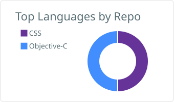
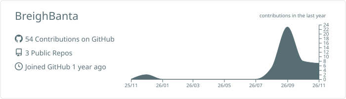

## Hi, I am Breigh!

I am a Student at Midway University studying <strong>Computer Science and Equine Management</strong>. I love animals, especially horses, and am looking for ways to bridge the gap between technology and the Equine Industry by exploring software development, data management, cybersecurity, and web development. 

<strong>Interests:</strong> Data management, Equine management and care, software and web development
<strong>Education:</strong> Pursuing a degree in Computer Science and Equine Management at Midway University

Here is my <strong>Homepage</strong>: https://github.com/BreighBanta/HomePage

### My Github

  <table>
    <tr>
      <th align="center">Top Languages</th>
      <th align="center">Profile Summary</th>
    </tr>
    <tr>
      <td align="center">
        
      </td>
      <td align="center">
        
      </td>
    </tr>
  </table>

